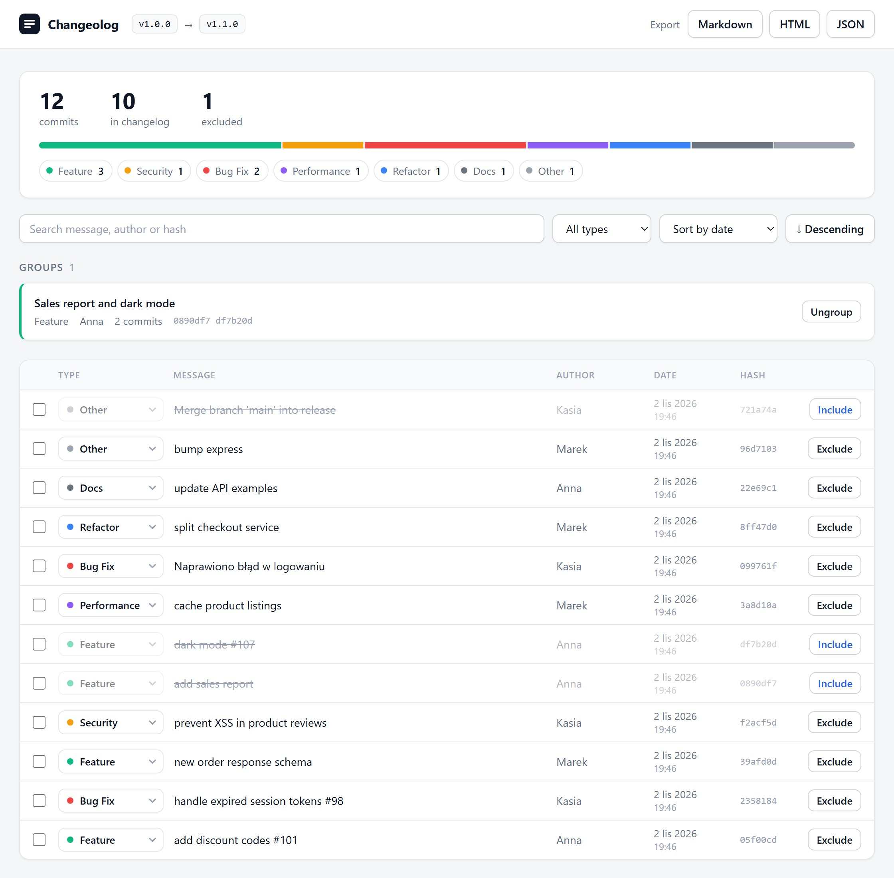
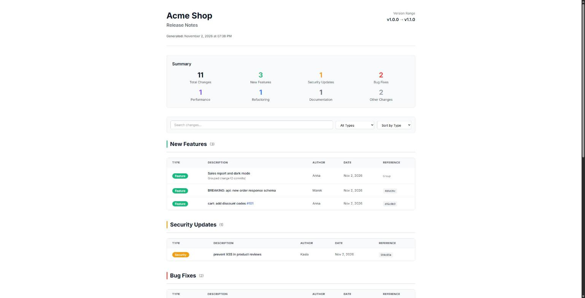

# Changeolog

[](https://github.com/BElluu/Changeolog/actions/workflows/ci.yml)
[](LICENSE)

Turn your git history into a clean changelog. Changeolog reads your commits, sorts them into types,
lets you review and group them in a local web editor, and exports Markdown, HTML or JSON. It can also
run unattended in CI. Built with [Bun](https://bun.sh) and TypeScript.



## Features

- Analyzes a git range (`--from` / `--to`) with an optional regex filter
- Understands [Conventional Commits](https://www.conventionalcommits.org), with English and Polish keyword fallback
- Local web editor: include/exclude, retype, reword and group commits
- Exports Markdown, HTML (full or simple, EN/PL) and JSON
- `generate` command for CI; `--update` keeps adding releases to an existing `CHANGELOG.md`
- Links commits and `#123` references (GitHub, GitLab, Bitbucket)

## Quick start

Requires [Bun](https://bun.sh) 1.0 or newer.

```bash
git clone https://github.com/BElluu/Changeolog.git
cd Changeolog
bun install
bun link          # makes the `changeolog` command available globally
```

Then, inside the repository you want a changelog for:

```bash
changeolog analyze --from v1.0.0     # read commits since the v1.0.0 tag
changeolog web                       # review and edit at http://127.0.0.1:3000
changeolog generate                  # or skip the editor and write CHANGELOG.md
```



## Documentation

Commands, configuration, how commits are classified, CI usage and the stage file format are in
[docs/](docs/). The guides are plain Markdown and are also built into a searchable site (Astro, see
[docs/development.md](docs/development.md)).

## Contributing

```bash
bun run check       # typecheck, lint and tests (same as CI)
```

Contributions are welcome, see [CONTRIBUTING.md](CONTRIBUTING.md). Please report security issues as
described in [SECURITY.md](SECURITY.md).

## License

[MIT](LICENSE)
