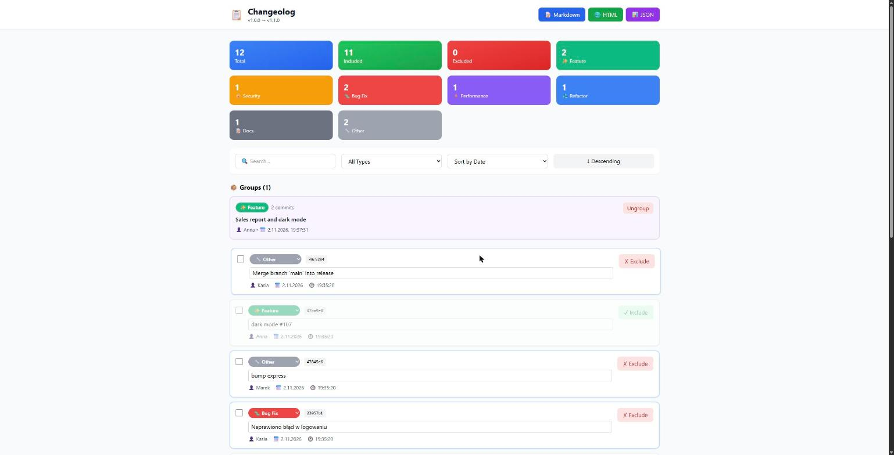

# Changeolog 📋

[](https://github.com/BElluu/Changeolog/actions/workflows/ci.yml)
[](LICENSE)

Turn your git history into a clean changelog. Changeolog reads your commits, sorts them into
types, lets you review and group them in a local web editor, and exports Markdown, HTML or JSON.
It can also run unattended in CI. Built with [Bun](https://bun.sh) and TypeScript.



## ✨ Features

- 🔍 Analyzes a git range (`--from` / `--to`) with an optional regex filter
- 🏷️ Understands [Conventional Commits](https://www.conventionalcommits.org) (scope, `!`, `BREAKING CHANGE:`) and falls back to English and Polish keywords
- 🧩 Seven types: Feature, Security, Bug Fix, Performance, Refactor, Docs, Other
- 🌐 Local web editor: include/exclude, retype, reword and group commits
- 📝 Exports Markdown, HTML (full or simple, EN/PL) and JSON
- 🤖 `generate` command for CI; `--update` keeps adding releases to an existing `CHANGELOG.md`
- 🔗 Links commits and `#123` references (GitHub, GitLab, Bitbucket)
- ⚙️ Optional config file for app name, repository URL and your own keywords

## 🚀 Quick start

Requires [Bun](https://bun.sh) 1.0 or newer.

```bash
git clone https://github.com/BElluu/Changeolog.git
cd Changeolog
bun install
bun link          # makes the `changeolog` command available globally
```

Then, inside the repository you want a changelog for:

```bash
changeolog analyze --from v1.0.0     # read commits since the v1.0.0 tag
changeolog web                       # review and edit at http://127.0.0.1:3000
```

Export from the editor, or skip it and write the file directly (the HTML export is a single searchable, filterable page):


```bash
changeolog generate                  # CHANGELOG.md
```

Without linking you can run `bun run src/cli.ts <command>` from the cloned folder instead.

## 📖 Commands

### `analyze`

Reads commits and writes the stage file (`.Changeolog_stage.json`).

| Option | Description |
|--------|-------------|
| `--from <ref>` | Start commit or tag (required) |
| `--to <ref>` | End commit or tag (default `HEAD`) |
| `--repo <path>` | Repository path (default `.`) |
| `--pattern <regex>` | Only keep commits whose message matches, e.g. `"^JIRA-\\d+"` |
| `--name <name>` | Application name shown in the changelog |
| `--release <name>` | Release label (default: the tag at `--to`, else `Unreleased`) |
| `--repo-url <url>` | Repository URL for links (default: taken from `origin`) |
| `--config <path>` | Config file (default `changeolog.config.json` if present) |

### `web`

Starts the editor on `127.0.0.1` (default port 3000, change with `--port`). It is a local tool and is
not reachable from other machines.

In the editor you can include or exclude commits, change types, edit messages, select several commits
and group them into a single entry, search, filter, sort, and export.

### `generate`

Writes the changelog straight from the stage file, no browser needed.

```bash
changeolog generate                                   # CHANGELOG.md
changeolog generate --update                          # insert this release at the top of an existing file
changeolog generate --format html --template simple --language pl -o docs/release.html
changeolog generate --format json -o -                # print to stdout
```

| Option | Description |
|--------|-------------|
| `--format` | `markdown` (default), `html` or `json` |
| `-o`, `--output` | Output file, `-` for stdout. Defaults to `CHANGELOG.md`, `CHANGELOG.html` or `changelog.json` |
| `--update` | Markdown only: merge into the existing file, newest release first. Re-running replaces the same `## [version]` section instead of duplicating it |
| `--template`, `--language` | HTML only: `full` or `simple`, `en` or `pl` |

### `clean`

Deletes the stage file.

## 🎨 How commits are classified

1. **Conventional Commits** (`type(scope)!: subject`) are parsed exactly. The prefix is removed from the
   message, the scope is kept, and `!` or a `BREAKING CHANGE:` footer marks the entry as breaking.
2. Everything else is matched against **English and Polish keywords**. The first matching type wins, in the
   order below, so "Fix new issue" is a bug, not a feature.
3. Commits that match nothing become **Other**.

| Type | Conventional prefixes | Keyword examples |
|------|-----------------------|------------------|
| 🔒 Security | `security`, `sec` | `security`, `vulnerability`, `cve`, `xss`, `bezpieczeństwo`, `podatność` |
| 🐛 Bug Fix | `fix`, `bugfix`, `hotfix` | `fix`, `bug`, `crash`, `napraw`, `błąd` |
| ⚡ Performance | `perf` | `performance`, `optimize`, `wydajność`, `optymalizacja` |
| ♻️ Refactor | `refactor` | `refactor`, `restructure`, `clean up`, `refaktoryzacja`, `przebuduj` |
| 📝 Docs | `docs`, `doc` | `docs`, `readme`, `documentation`, `dokumentacja` |
| ✨ Feature | `feat`, `feature` | `add`, `new`, `implement`, `dodaj`, `nowy`, `wdroż` |
| 🔧 Other | `chore`, `ci`, `build`, `test`, `style`, `deps`, `revert` | anything unmatched |

Automatic detection is a best effort. Fix any entry in the web editor.

## ⚙️ Configuration

Create `changeolog.config.json` in the directory where you run Changeolog (or pass `--config <path>`):

```json
{
  "appName": "My App",
  "repoUrl": "https://github.com/owner/repo",
  "patterns": {
    "bug": ["^hotfix", "^poprawka"],
    "docs": ["^wiki"]
  }
}
```

- `appName` – default application name (`--name` overrides it).
- `repoUrl` – repository URL for links. Detected from `origin` when omitted; credentials in the URL are never used.
- `patterns` – extra case-insensitive regular expressions per type (`feature`, `security`, `bug`, `perf`,
  `refactor`, `docs`, `other`), checked before the built-in keywords. This is the easy way to support another
  language or a project-specific convention.

## 🔗 Releases and links

- If `--to` points exactly at a tag (for example `--to v1.2.0`), the tag becomes the release name and its
  commit date the release date. Otherwise the section is called `Unreleased`.
- Commit hashes and `#123` references are linked to GitHub, GitLab or Bitbucket.

Example of the Markdown output:

```markdown
## [v1.2.0] - 2026-01-14

### ✨ New Features

- BREAKING: api: new response schema (John Doe) [`a1b2c3d`](https://github.com/owner/repo/commit/a1b2c3d…)
- dark mode [#7](https://github.com/owner/repo/issues/7) (Jane Smith) [`e4f5a6b`](https://github.com/owner/repo/commit/e4f5a6b…)

### 🐛 Bug Fixes

- crash on start (Jane Smith) [`c7d8e9f`](https://github.com/owner/repo/commit/c7d8e9f…)
```

## 🤖 Using it in CI

```yaml
- run: |
    bunx changeolog analyze --from ${{ steps.prev.outputs.tag }} --to ${{ github.ref_name }}
    bunx changeolog generate --update
```

This is a sketch: Changeolog is not published to npm yet, so install it from source in your pipeline.

## ❓ Troubleshooting

| Problem | What to check |
|---------|---------------|
| "No commits found" | The `--from` ref exists (`git tag`, `git log --oneline`), and `--pattern` is a valid regex. Remember to escape backslashes in the shell (`"\\d+"`) |
| "No stage file found" | Run `changeolog analyze` first, in the same directory |
| Port already in use | Pass another port: `changeolog web --port 8080` |
| Wrong type detected | Change it in the editor, use Conventional Commits, or add `patterns` to the config file |
| Old stage file shows old types | Run `changeolog analyze` again |

The stage file format is described in [docs/stage-file.md](docs/stage-file.md).

## 🛠️ Development

```bash
bun install
bun run check       # typecheck, lint and tests (same as CI)
bun test            # tests only
bun run build       # bundle to dist/
```

```
src/
├── cli.ts            # command line entry point
├── classifier/       # Conventional Commits parsing + keyword fallback
├── config/           # changeolog.config.json loading and validation
├── export/           # format → generator mapping, changelog merging
├── git/parser.ts     # reads commits with simple-git
├── links.ts          # repository URL and commit/issue links
├── stage/            # stage file read/write/validation
├── types/            # commit types and display configuration
├── util/html.ts      # HTML and JSON escaping helpers
└── web/              # editor, HTML/Markdown/JSON generators, local server
```

Contributions are welcome, see [CONTRIBUTING.md](CONTRIBUTING.md). Please report security issues as
described in [SECURITY.md](SECURITY.md).

## 📄 License

[MIT](LICENSE)
